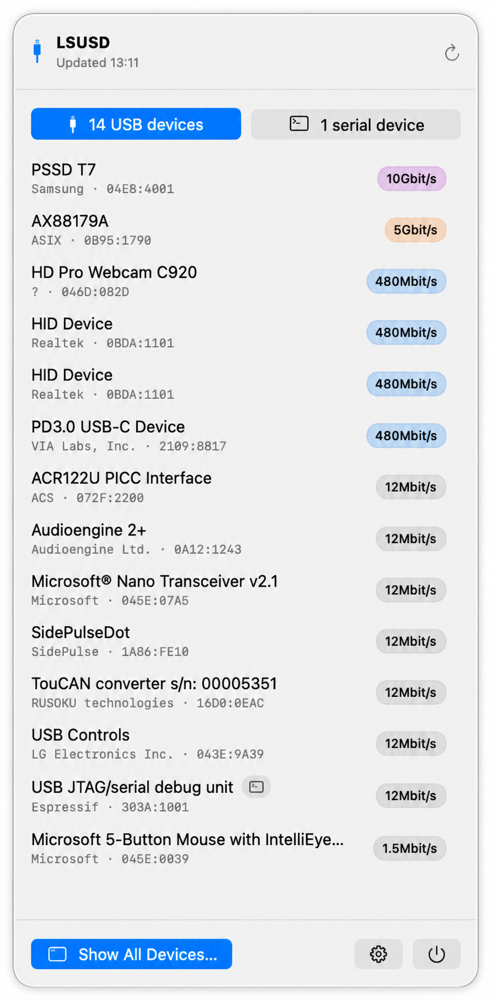

# lsusd — List USB Devices

A zero-dependency `lsusb` successor for macOS and Linux. `lsusd` lists USB
devices with their USB metadata (bus, address, vendor, product, serial number,
VID:PID, device release, speed) and available serial device nodes, and can
render the physical USB tree. The original USB serial device view is kept
for compatibility.

The repository also contains **LSUSD for macOS**, a native macOS 26 menu-bar
app that presents the CLI's discovery, topology, serial monitoring, and export
features in a professional SwiftUI interface. The app talks to IOKit directly;
it neither launches nor parses the Python CLI.

One practical motivation for `lsusd` is that Homebrew's macOS `lsusb` formula
is a shell wrapper around `system_profiler SPUSBDataType`. On newer macOS
systems that data type can return no devices even when many USB devices are
connected; the USB data is available through `ioreg` and `SPUSBHostDataType`
instead. `lsusd` uses the IOKit registry directly, so it does not depend on
that stale `system_profiler` data type.

## What's new in CLI 2.1.2

- Shows available serial ports directly in the default USB device list and tree,
  including multiple ports belonging to one device.
- Replaces the Location ID column with Device Node. **Scripts:** the `device`
  field replaces `location` in CSV/JSON and the third column of plain output.
- Displays missing values as `—`, including USB serial numbers. Plain, CSV,
  and JSON retain `?` for compatibility.
- Adds automatic terminal colors for device nodes, USB IDs, speeds, and watch
  events. `NO_COLOR` or `TERM=dumb` disables styling; data formats stay unstyled.
- Keeps `--serial` as the original per-port view for compatibility.

See the [changelog](CHANGELOG.md) for CLI and macOS app release history.

## Native macOS menu-bar app

The app lives in [`macOS/`](macOS/README.md) and targets macOS 26 or later. Its
menu-bar label shows the current USB and USB-serial device counts as
`USB·serial`. IOKit first-match and termination notifications keep the label,
the popover, and the event history current without polling.

The compact popover provides switchable USB and serial device lists plus
inline settings and quit controls. A separate device window covers the full
CLI surface: device details, optional hubs, expandable topology, serial device
nodes, event history, and plain-text, CSV, and JSON export.

<p align="center">
  
</p>

### What's new in macOS 2.1.3

- Shows available serial device nodes in the USB list, topology, inspector,
  menu-bar panel, and exports, including multiple ports per device.
- Copies individual serial port paths from a right-click menu.
- Uses the CLI-compatible `device` export field in place of `location`.

See the complete [changelog](CHANGELOG.md) for release history.

The app is deliberately independent from the CLI package. Install either or
both products:

```bash
brew install lsusd
brew install --cask lsusd-menubar
```

For local development, install XcodeGen and Shark, then use:

```bash
make mac-build
make mac-test
make mac-run
```

The interface uses the macOS system typeface and native system controls; no
custom fonts are bundled.

## Example Output

```
❯ lsusd
┌─────┬────────┬─────────────────────────┬────────────────────────────┬────────────┬───────────────────┬───────────┬─────────┬───────┐
│ Bus │ Device │       Device Node       │        USB Product         │ USB Vendor │     USB Serial    │  VID:PID  │ Release │ Speed │
├─────┼────────┼─────────────────────────┼────────────────────────────┼────────────┼───────────────────┼───────────┼─────────┼───────┤
│ 001 │ 003    │ —                       │ AX88179A                   │ ASIX       │ 00000000003C6D    │ 0B95:1790 │ 2.00    │ 5G    │
├─────┼────────┼─────────────────────────┼────────────────────────────┼────────────┼───────────────────┼───────────┼─────────┼───────┤
│ 002 │ 013    │ /dev/cu.usbmodem2121101 │ USB JTAG/serial debug unit │ Espressif  │ 34:85:18:AA:B7:C8 │ 303A:1001 │ 1.01    │ 12M   │
├─────┼────────┼─────────────────────────┼────────────────────────────┼────────────┼───────────────────┼───────────┼─────────┼───────┤
│ 008 │ 002    │ —                       │ PSSD T7                    │ Samsung    │ S5TDNS0RB02541D   │ 04E8:4001 │ 1.00    │ 10G   │
└─────┴────────┴─────────────────────────┴────────────────────────────┴────────────┴───────────────────┴───────────┴─────────┴───────┘
```

In an interactive terminal, device nodes appear green, VID:PID values cyan,
and product names bold. Link speeds use magenta for SuperSpeed (1G and above),
cyan for high speed (480M and above), and yellow for slower links. Unknown
values appear as a dimmed em dash (`—`), including USB serial numbers.
Color is disabled when output is redirected, `TERM=dumb`, or `NO_COLOR` is
set. Plain, CSV, and JSON output always remain unstyled and retain `?` for
unknown values.

### Tree Output

```
❯ lsusd --tree --hubs
├─ Bus 002 Dev 001 ID 0451:8142 Texas Instruments USB Hub release=1.00 speed=480M hub
│  ├─ Bus 002 Dev 002 ID 17CC:1340 Native Instruments KOMPLETE KONTROL S25 release=1.00 speed=480M serial=D1141A43
│  └─ Bus 002 Dev 013 ID 303A:1001 Espressif USB JTAG/serial debug unit release=1.01 speed=12M device=/dev/cu.usbmodem2121101 serial=34:85:18:AA:B7:C8
└─ Bus 008 Dev 002 ID 04E8:4001 Samsung PSSD T7 release=1.00 speed=10G serial=S5TDNS0RB02541D
```

## Installation

### pip / pipx

```bash
pip install lsusd
# or
pipx install lsusd
```

### Homebrew

```bash
brew tap mickeyl/formulae
brew install lsusd
```

### From source

```bash
pip install -e .
```

Run from the repository root. Alternatively, `make install` installs an editable
copy into the current Python environment; `make check` compiles the sources,
runs the unit tests, and checks the CLI entry point.

## Usage

```bash
lsusd
# or
python -m lsusd
```

### Options

| Flag | Description |
|------|-------------|
| `-p`, `--plain` | Tab-separated output, no headers — suitable for `cut`, `awk`, etc. |
| `-c`, `--csv` | CSV output with header row |
| `-j`, `--json` | JSON array output, or JSON Lines in watch mode |
| `-n`, `--no-spinner` | Disable the progress spinner |
| `-w`, `--watch` | Watch USB serial devices in a live table |
| `-a`, `--all` | Show all non-hub USB devices (default; kept for compatibility) |
| `--serial` | Original USB serial device view (kept for compatibility) |
| `--hubs` | Include USB hubs in device and tree output |
| `-t`, `--tree` | Show USB devices as a tree |
| `--version` | Print version and exit |

### USB Device Mode

```bash
lsusd
lsusd --all
lsusd --all --hubs
lsusd --plain
lsusd --json
lsusd --tree
lsusd --tree --hubs
```

By default, `lsusd` lists all non-hub USB devices visible to the platform.
`--all` is kept as an explicit alias for this default mode. Add `--hubs` to
include USB hubs. The columns are `bus`, `address`, `device`, `product`,
`vendor`, `serial`, `vidpid`, `release`, and `speed` in table, plain, CSV, and
JSON output.

`device` (the `Device Node` table column) contains the available USB serial
ports, such as `/dev/ttyACM0` on Linux or `/dev/cu.usbmodem2121101` on macOS.
Multiple ports belonging to one USB device are joined with `, `; devices
without a serial port show `—` in the table (`?` in plain, CSV, and JSON).
Ports are matched by their physical USB ancestor, so identical adapters remain
distinguishable. The Location ID column has been removed; location information remains internal for device
ordering and port matching. Since CLI 2.1.2, scripts must read `device` instead
of `location`; the third plain-text column now contains serial device nodes.

`release` is the BCD-coded `bcdDevice` value from the standard USB device
descriptor. Manufacturers commonly use it for the device's firmware release,
but USB defines it more generally as a manufacturer-assigned device release
number. It uses the conventional USB two-group notation (`0x0100` becomes
`1.00`); `lsusd` does not infer a major/minor/patch version. A device that does
not expose the value is shown as `—` in human-readable output (`?` in plain,
CSV, and JSON).

`--tree` shows the USB device hierarchy. Like `--all`, it hides hubs by default
and includes them with `--hubs`. Available serial ports appear as `device=...`.

On macOS, both modes use the IOKit `IOUSB` registry plane for USB devices
and the `IOService` plane for serial port association, avoiding the stale
`SPUSBDataType` dependency used by older `lsusb` wrappers.

### USB Serial Mode (Compatibility)

```bash
lsusd --serial
lsusd --serial --plain
lsusd --serial --json
```

`--serial` is kept for compatibility and shows the original lsusd view:
one row per USB serial device node, mapped to its USB metadata. The columns
are `device`, `product`, `vendor`, `serial`, `vidpid`, and `release`.

### Watch Mode

```bash
lsusd --watch
lsusd --watch --plain
lsusd --watch --json
```

`--watch` shows a live terminal table of connected USB serial devices and
redraws it after add/remove events. The machine-readable formats still emit
event streams: `--plain` and `--csv` use the columns `action`, `device`,
`product`, `vendor`, `serial`, `vidpid`, and `release`; `--json` emits
newline-delimited JSON objects. Initial devices use action `present`.
In the live table, the last event uses green for additions and red for removals.
Watch log output without a terminal uses em dashes for unknown values and has
no colors.

```
❯ lsusd --watch
lsusd watch  1 USB serial device(s)  2026-10-17T14:22:09
Press Ctrl-C to stop.

┌─────────────────────────┬────────────────────────────┬────────────┬────────────┬───────────┬─────────┐
│       Device Node       │        USB Product         │ USB Vendor │ USB Serial │  VID:PID  │ Release │
├─────────────────────────┼────────────────────────────┼────────────┼────────────┼───────────┼─────────┤
│ /dev/cu.usbmodem2121101 │ USB JTAG/serial debug unit │ Espressif  │ —          │ 303A:1001 │ 1.01    │
└─────────────────────────┴────────────────────────────┴────────────┴────────────┴───────────┴─────────┘
```

The watch implementation is push-driven, not a polling loop. On macOS, lsusd
subscribes to IOKit `IOSerialBSDClient` first-match and termination
notifications. On Linux, lsusd listens to kernel uevents through the netlink
socket. After an event arrives, lsusd takes a fresh snapshot only to compute the
added or removed device rows.

## Supported Platforms

- **macOS** — discovers USB devices via the `ioreg` `IOUSB` plane and associates
  callout nodes from `IOService` with their physical USB ancestor. The compatibility
  serial view maps `/dev/cu.usbmodem*` and `/dev/cu.usbserial*`.
- **Linux** — discovers devices via sysfs (`/sys/bus/usb/devices` for USB device mode; any tty with a USB ancestor for serial mode)

## License

MIT
